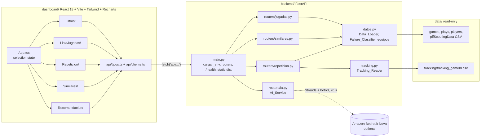
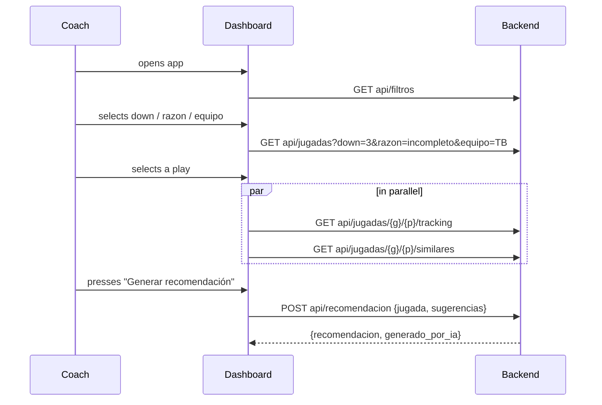

# Design Document: Failed Plays Coach App

## Overview

Failed Plays Coach App lets a coach pick a down, a failure reason and a team, review the matching failed pass plays (NFL Big Data Bowl 2023, 2021 season, weeks 1-8), replay one play in 2D, and compare it with effective plays from other teams in a similar situation. An optional AI layer (Amazon Bedrock Nova through Strands Agents) rewrites the structured suggestions as a short Spanish text. Without AI, a fixed-template text is returned.

Key design decisions:

| Decision | Rationale |
|---|---|
| Derive every table once at startup and keep it in memory (pandas, no disk writes). | Requirements 1.10, 4.8 and 11.2. `plays.csv` is small, so `GET /api/jugadas` is a pandas filter over a precomputed frame. |
| Read tracking lazily, one file per request, with `usecols` and a `playId` filter. | Files are about 7 MB each. Loading all games at startup would break the 30 s startup limit (11.3) and the one-file rule (11.5). |
| The Failure_Classifier is a vectorized pure function over a DataFrame. | Easy to test as a property, and it makes the precedence rule explicit in one place. |
| Full team names come from a static abbreviation-to-name dictionary in `backend/datos.py`. | `games.csv` only has `homeTeamAbbr` and `visitorTeamAbbr`. Requirement 3.3 allows a team to be returned with its abbreviation only, so an unknown abbreviation gets `nombre: null`. |
| Similarity matching, relaxation, suggestions and the comparison live in pure functions that take DataFrames and return plain dicts. | Routers stay thin, and pytest can test the logic without HTTP or files. |
| The AI layer is imported lazily inside the request handler, and the fallback text is always computed first. | `strands`/`boto3` import errors, missing credentials or timeouts cannot break the endpoint (10.7). |
| `data/` is never written. Responses are built in memory. | Rules: ephemeral server, `data/` read-only. |

Clarifications of the requirements adopted by this design:

1. The glossary says the effectiveness rule is in Requirement 6. It is in Requirement 7.1.
2. Requirement 7.2 lists three fields for the Similares object, and Requirement 8 requires comparison data. The design adds a fourth field `comparacion` to the `Similares` object (see Data Models). `similares`, `sugerencias` and `criteriosRelajados` keep the exact shape of 7.2.
3. Requirement 8.3-8.4 say "the similar plays". The design computes them over the plays returned in `similares` (at most 20). Requirement 8.5 (success rate and average yards per formation) uses the wider group of Requirement 8.5 itself, and its sample size is that group size.
4. Requirement 9.9 requires `nMuestra <= len(similares)`. Therefore `nMuestra` always counts plays inside the returned `similares` list. A figure computed on the wider 8.5 group is only cited in `evidencia` text together with its own group size.
5. The effectiveness rule and the classifier only consider `down` 1-4. A play with `down` 0 is neither failed nor effective.

## Architecture



### Request flows



### Startup

`backend/main.py` defines and calls `cargar_env()` before importing any module that imports `boto3` (Requirement 1.2). Routers import `boto3`/`strands` lazily, so only `ia.py` is affected, but the order is respected anyway. A FastAPI `lifespan` handler calls `datos.cargar()`. If a CSV is missing, `cargar()` raises `RuntimeError("No se encontró el archivo <nombre>")` and the lifespan aborts startup (11.4). After startup, the same `datos` module-level state is read-only for all requests.

Production serving (11.7): after all `/api` routers and `/health` are registered, `main.py` mounts `dashboard/dist` with `StaticFiles(directory=..., html=True)` at `/` only if the directory exists. The mount is last so it cannot shadow the API.

### Work split and ownership

| Owner | Backend | Dashboard |
|---|---|---|
| Shared skeleton (step 0) | `backend/main.py`, stubs of the four routers and of `datos.py` and `tracking.py` public functions | `src/App.tsx`, `src/api/tipos.ts`, `vite.config.ts`, empty component folders |
| Person A | `backend/datos.py`, `routers/jugadas.py`, `routers/similares.py` | `Filtros/`, `ListaJugadas/`, `Similares/` |
| Person B | `backend/tracking.py`, `routers/repeticion.py`, `routers/ia.py` | `Repeticion/`, `Recomendacion/` |

Cross-owner interface, frozen in step 0 as a stub with docstrings, so that nobody edits the other person's file:

- `datos.obtener_jugada(game_id: int, play_id: int) -> dict | None`. It returns a dict with at least `equipo` (possession team abbreviation). Person B's `repeticion.py` calls it to get the offense team and to answer 404 for unknown plays. The stub returns `None` until Person A implements it.
- `App.tsx` owns the selection state (`filtros`, `jugadaSeleccionada`) and passes props to the components. Components do not import each other.
- Each component folder exports one default component with the props listed under Components and Interfaces.

## Components and Interfaces

### Backend

#### `backend/datos.py` (Person A): Data_Loader and Failure_Classifier

```python
EQUIPOS: dict[str, str]  # 'ARI' -> 'Arizona Cardinals', ... 32 teams, includes 'LA', 'LAC', 'LV', 'WAS'

def cargar(data_dir: Path = DATA_DIR) -> None
def clasificar_fallas(plays: pd.DataFrame) -> pd.DataFrame
def parsear_personal(texto: str | None) -> dict[str, int] | None
def formatear_personal(conteos: dict[str, int]) -> str
def obtener_jugada(game_id: int, play_id: int) -> dict | None
def jugadas_fallidas() -> pd.DataFrame
def jugadas_efectivas() -> pd.DataFrame
def todas_las_jugadas() -> pd.DataFrame
def alineaciones(game_id: int, play_id: int) -> pd.DataFrame
```

`DATA_DIR = Path(__file__).resolve().parent.parent / "data"`. Reads use `pd.read_csv(..., keep_default_na=True)`; `pffScoutingData.csv` uses `NA` for missing values, which pandas already maps to NaN.

**Failure_Classifier** (`clasificar_fallas`). Input: the plays frame. Output: the frame with columns `razon` (string or `None`) and `descripcion`. Steps:

1. Coerce `gameId, playId, down, yardsToGo, playResult` with `pd.to_numeric(errors="coerce")`. Rows with any NaN in these five columns get `razon = None` (Requirement 2.12). Other rows are not altered.
2. Rows with `down` not in {1, 2, 3, 4} get `razon = None` (2.1, includes down 0, which has 35 rows).
3. Apply the rules with `numpy.select` in precedence order (2.7):

| Order | Condition | razon |
|---|---|---|
| 1 | `passResult == "IN"` | `intercepcion` |
| 2 | `passResult == "S"` | `sack` |
| 3 | `passResult == "I"` | `incompleto` |
| 4 | `playResult < 0` | `perdida_de_yardas` |
| 5 | `down in (3, 4) and playResult < yardsToGo` | `sin_conversion` |
| default | none | `None` |

`numpy.select` returns the first matching choice, so each play gets at most one reason and the function is deterministic and idempotent (2.10). `passResult` values in the data are `C, I, S, R, IN`. A scramble (`R`) is only a failure through rules 4 or 5.

4. `descripcion` for a failed play is `f"{ordinal} down y {yardsToGo} yardas por ganar: {etiqueta_razon}"`, where `etiqueta_razon` is a fixed Spanish phrase per reason that contains the reason code, for example `razón sin_conversion`. The text is truncated to 200 characters (2.8) and always contains the `down`, the `yardsToGo` and the `razon` code. For example: `Down 3 y 7 yardas por ganar. Razón de falla: incompleto.`

The loaded tables, all built once in `cargar()`:

- `_plays`: all plays with `razon`, `descripcion`, and the parsed personnel counts.
- `_fallidas`: `_plays` where `razon` is not null, sorted by `gameId, playId`, with the Jugada columns renamed (`possessionTeam -> equipo`, `defensiveTeam -> rival`, `offenseFormation -> formacion`, `personnelO -> personal`, `pff_passCoverage -> cobertura`).
- `_efectivas`: plays with `razon` null, `down` in 1-4, `passResult == "C"`, and `playResult >= umbral * yardsToGo`, with umbral 0.4, 0.6, 1.0, 1.0 for downs 1-4 (7.1).
- `_pff`: `pffScoutingData` left-joined with `players.officialPosition` on `nflId`, indexed by `(gameId, playId)` for quick access.
- `_equipos_con_fallas`: sorted unique `equipo` values of `_fallidas`.

`games.csv` is loaded and validated (11.4), and it is used to check that every `gameId` in `plays.csv` has a game. Team names come from `EQUIPOS`.

**Personnel parsing.** `parsear_personal("1 RB, 1 TE, 3 WR")` returns `{"RB": 1, "TE": 1, "WR": 3}` using the regex `^\s*(\d+)\s+([A-Z]+)\s*$` on each comma-separated token. Any token that does not match, a negative or non-integer count, or a null input returns `None` (12.10); the original text stays in `personal` and the counts are missing for that row. `formatear_personal` prints counts as `"<n> <POS>"` joined by `", "` in the order of insertion, so parsing a printed text gives equal counts (12.9).

**NaN handling (12.4).** `a_jugada(row)` is the single function that converts a row into the Jugada dict. It maps `NaN`, `pd.NA` and `None` to `None` and numpy integer types to Python `int`. The same helper is used for similares rows.

#### `backend/routers/jugadas.py` (Person A)

`GET /api/filtros` returns:

```json
{"downs": [1,2,3,4],
 "razones": ["incompleto","intercepcion","sack","sin_conversion","perdida_de_yardas"],
 "equipos": [{"abbr": "ARI", "nombre": "Arizona Cardinals"}, ...]}
```

Teams are the sorted unique `equipo` values of the failed plays (3.2, 3.4). `nombre` is `EQUIPOS.get(abbr)` and is `null` when absent (3.3). If `datos` is not loaded, the endpoint answers 500 with `{"detail": "No se pudieron cargar los datos."}` and no partial lists (3.5).

`GET /api/jugadas?down=&razon=&equipo=`. Parameters are declared as `str | None` and validated manually so that the error is the Spanish message in 4.5:

- `down` must parse to an integer in 1-4; otherwise 422 with `"El parámetro 'down' debe ser un entero entre 1 y 4."`
- `razon` must be one of the five codes; otherwise 422 naming `razon`.
- `equipo` is an exact, case-sensitive match against the abbreviation, and it is not validated against the list (an unknown team gives an empty list with 200).

A custom handler for `RequestValidationError` in `main.py` produces the same Spanish format for any other FastAPI validation error (for example a non-integer `gameId` in a path). The filter is a boolean mask over the precomputed `_fallidas` frame, which is already sorted by `gameId, playId` (4.6, 4.7). The response is a list of Jugada models (see Data Models).

#### `backend/routers/similares.py` (Person A): Similar_Finder

`GET /api/jugadas/{gameId}/{playId}/similares?misma_cobertura=false`.

Pure functions, so they can be tested without HTTP:

```python
def buscar_similares(jugada: dict, efectivas: pd.DataFrame, misma_cobertura: bool) -> tuple[pd.DataFrame, list[str], dict]
def construir_comparacion(jugada, similares, grupo_8_5, tolerancia) -> dict
def generar_sugerencias(jugada, similares, comparacion) -> list[dict]
def etiqueta_confianza(n: int) -> str
```

**Selection and relaxation** (7.3-7.9). The state is a small dict `criterios = {personnelO: True, yardsToGo_tol: 2, offenseFormation: True}`:

1. Base mask: `efectivas.equipo != jugada.equipo` and `efectivas.down == jugada.down` (these two never relax).
2. If the requested play has a null `formacion`, `personal` or (when `misma_cobertura=true`) `cobertura`, the matching criterion is dropped from the start and its identifier is added to `criteriosRelajados` (7.8). For a null `cobertura` and `misma_cobertura=true`, the identifier is `pff_passCoverage`. For a null `cobertura` and `misma_cobertura=false`, nothing is dropped because coverage is not a criterion in that mode.
3. Apply `abs(yardsToGo - jugada.yardsToGo) <= tol`, `formacion == formacion` and `personal == personal` when active. With `misma_cobertura=true`, also `cobertura ==` (never relaxed, 7.7).
4. If fewer than 5 rows match, apply the next step: (1) drop `personnelO`; (2) set tolerance to 4; (3) drop `offenseFormation`. After each step the mask is recomputed, and the loop stops once 5 or more rows match or all three steps were applied (7.9). Each applied step appends its identifier to `criteriosRelajados` (`personnelO`, `yardsToGo`, `offenseFormation`). A step already covered by a null-value drop is skipped, and it is not listed twice.
5. Order by `playResult` descending, `gameId` ascending, `playId` ascending, and keep the first 20 (7.11).

The `similares` elements carry `gameId, playId, equipo, rival, yardsToGo, playResult, formacion, personal, cobertura` (7.10). The invariants of 7.14 hold by construction of step 1.

**Comparison** (Requirement 8). `construir_comparacion` returns:

```python
{
  "solicitada": {"formacion", "personal", "alineacion": [str]},       # for the side-by-side view
  "distribucion": {"formacion": [{valor, porcentaje, nMuestra}], "personal": [...], "cobertura": [...]},  # percentages with 1 decimal
  "alineaciones": [{"posicion": str, "rol": str, "conteo": int}],     # top 10
  "rutasDisponibles": bool,
  "exitoPorFormacion": [{"formacion": str, "tasaExito": float, "yardasPromedio": float, "nMuestra": int}],
  "top3": {"formacion": [str], "personal": [str], "alineacion": [str]}
}
```

- Alignment (8.1-8.2, 8.3): rows of `_pff` for the similar plays with `pff_role == "Pass Route"` and `officialPosition in {"WR","TE","RB","FB"}`. `Pass`, `Pass Block`, `Pass Rush` and `Coverage` rows are excluded. A `groupby(["pff_positionLinedUp","pff_role"]).size()` is sorted by count descending then `pff_positionLinedUp` ascending, and the top 10 are returned. The same filter applied to the requested play gives `solicitada.alineacion` (the list of `pff_positionLinedUp` values, sorted).
- `rutasDisponibles` is false when `_pff` has no rows for the requested play (8.8). All other comparison data is returned unchanged, and the alignment lists are empty.
- Distributions (8.4): `100 * count / len(similares)` rounded to 1 decimal for each value of `formacion`, `personal` and, where it is not null for at least one similar play, `cobertura`. The sample size is `len(similares)`.
- Success rate and average yards (8.5): the group is all plays in `_plays` (with `down` 1-4) from other teams with the same `down` and `abs(yardsToGo - yardsToGo_solicitada) <= tolerancia_aplicada`. `tasaExito` is `100 * (effective plays) / (group size)` and `yardasPromedio` is the mean of `playResult`, both with 1 decimal, per `formacion`. The `nMuestra` is the group size of that formation.
- `top3` (8.6) holds the 3 most frequent values among the similar plays, ties broken alphabetically.

**Suggestions** (Requirement 9). Candidates are generated in a fixed order, then discarded when `nMuestra == 0`, ordered by `nMuestra` descending with a stable sort (so ties keep generation order), and cut to 5. Candidate templates, all fixed Spanish text:

1. Most common `formacion` among similar plays: "Considerar la formación {X}." Evidencia: "{n} de {N} jugadas efectivas similares usaron {X}; éxito de la formación {t} % en {M} jugadas del mismo down."
2. Most common `personal`.
3. Most common `cobertura` rival (when not null).
4. Most common alignment `pff_positionLinedUp` in the route data (only if `rutasDisponibles`).
5. Highest average `playResult` among the formations present in similar plays: "Ganancia promedio de {y} yardas con {X}."

`nMuestra` is the count of similar plays that carry the value named in the suggestion, so it is at most `len(similares)` (9.9). `texto` and `evidencia` are cut to 280 characters. `etiqueta_confianza(n)` returns `baja` for 1-4, `media` for 5-14 and `alta` for 15 or more (9.2). The output depends only on the data and the request, so the result is deterministic (9.10). An empty list is a valid result (9.8, 7.13).

**Errors.** Unknown `(gameId, playId)` among all plays gives 404 `"Jugada no encontrada."` (7.12). A play that exists but is not a failed play (for example a successful play) is still valid input for this endpoint, because the requirement only asks for existence.

#### `backend/tracking.py` (Person B): Tracking_Reader

```python
COLUMNAS = ["playId", "frameId", "nflId", "team", "x", "y", "event", "playDirection"]

def leer_tracking(game_id: int, play_id: int, equipo_ofensivo: str, data_dir: Path = DATA_DIR) -> dict | None
def normalizar(x, y, direccion: str) -> tuple[...]
def a_modelo(df: pd.DataFrame, equipo_ofensivo: str) -> dict
```

The file is `data/tracking/tracking_<gameId>.csv`. `gameId` is parsed as `int` by the router, then formatted into the file name, so a path-traversal string can never reach the file system. Steps in `leer_tracking`:

1. If the file does not exist, return `None` (404 in the router, 5.9).
2. `pd.read_csv(ruta, usecols=COLUMNAS, dtype={"team": "string", "event": "string", "playDirection": "string"}, keep_default_na=False, na_values=[""], converters unused)`. The `event` column in the files is the literal string `None` when empty; `keep_default_na=False` with `na_values=[""]` keeps `None` as a string so it can be treated as no event explicitly, and `NA` strings in numeric columns are handled by the numeric coercion in step 3. Only about 7 MB is read, and nothing else (5.2, 11.5).
3. Filter `playId == play_id`. If empty, return `None`. Coerce `frameId, nflId, x, y` with `pd.to_numeric(errors="coerce")`. A bad value becomes missing and the rest of the row is kept (12.8). Rows with missing `frameId` are dropped because they cannot be placed in a frame. `time` is not requested in `usecols`, because the response contract has no time field. If a future change reads it, it must use `pd.to_datetime(errors="coerce", utc=True)` (12.7).
4. `playDirection` is the first non-null value of the play. For `left`: `x' = 120 - x`, `y' = 53.3 - y`; for `right`, unchanged (5.4, 5.5). Any other direction is treated as `right`.
5. Players (`team != "football"`) with a valid `nflId`, `x` and `y` are clamped to `0 <= x <= 120` and `0 <= y <= 53.3` after the transform (5.10), then rounded to 2 decimals. The ball (`team == "football"`) is transformed and rounded but not clamped, because the ball can legitimately leave the 0-120 range by a small margin, and the clamp requirement (5.10) only covers players on the field. `equipo` is `ofensiva` when `team == equipo_ofensivo`, otherwise `defensiva` (5.7).
6. `cuadros` has one entry per distinct `frameId`, ascending, with up to 22 players and `balon` or `null` (5.6).
7. `eventos`: rows with `event` not null, not empty after `strip()` and not equal to `"None"`, converted to unique `(frame, evento)` pairs sorted by `frame` then `evento` (5.8). Events are in the data on one player row per frame, so deduplication is needed.

The mean-x property of 5.12 is a data-quality property of the normalization over many plays. It is tested with a sample of plays and not by an assertion inside the reader.

A small `functools.lru_cache(maxsize=16)` over `(game_id, play_id)` keeps the built dict (about 150 frames, a few hundred KB each) in memory only, without disk writes, to make repeated requests for the same play instant. The cache holds the result, not the DataFrame, so no more than one tracking file is loaded per request.

#### `backend/routers/repeticion.py` (Person B)

`GET /api/jugadas/{gameId}/{playId}/tracking` calls `datos.obtener_jugada` to get `equipo`. If it returns `None`, the router answers 404 `"No se encontraron datos de tracking para esta jugada."` (the same message as a missing file, to keep one error shape). It then calls `tracking.leer_tracking`. A `None` result is also a 404 (5.9). The synchronous `read_csv` call is declared in a plain `def` endpoint so FastAPI runs it in its thread pool and other requests stay responsive. Expected time is under 0.5 s for a 7 MB file, which leaves margin for the 2 s limit (5.13).

#### `backend/routers/ia.py` (Person B): AI_Service

`POST /api/recomendacion` with body `{jugada: Jugada, sugerencias: Sugerencia[0..20]}`, where `Sugerencia` includes `confianza`. Pydantic validates the body, so a missing body, invalid JSON or a wrong type gives 422 before any Bedrock call (10.9). The Spanish message comes from the shared `RequestValidationError` handler in `main.py`, which names the failing field.

Flow of the handler:

1. Compute `texto_respaldo = construir_respaldo(jugada, sugerencias)`, a pure function with fixed Spanish templates (10.8). With no suggestions it returns `"No hay sugerencias disponibles para esta jugada."`.
2. Build the prompt from the received data only. The system prompt tells the model to answer in Spanish, in at most 1,500 characters, to cite `nMuestra` for each suggestion it mentions, and to state no figure that is absent from the data (10.6).
3. Call `generar_con_ia(prompt)` in a worker thread with `asyncio.wait_for(..., timeout=20)` (10.7). Inside:

```python
region = os.environ.get("AWS_REGION", "us-east-1")
modelo = os.environ.get("BEDROCK_MODEL_ID", "us.amazon.nova-pro-v1:0")
from strands import Agent
from strands.models import BedrockModel
import boto3
cliente = boto3.client("bedrock-runtime", region_name=region)
agente = Agent(model=BedrockModel(model_id=modelo, boto_session=None, client=cliente), system_prompt=SISTEMA, callback_handler=None)
texto = str(agente(prompt))
```

The exact `BedrockModel` constructor arguments must be confirmed against `strands-agents 1.64.0` when Person B implements this file. Only the region is passed to boto3; the code never reads, checks or logs `AWS_ACCESS_KEY_ID`, `AWS_SECRET_ACCESS_KEY` or `AWS_SESSION_TOKEN` (10.4). No other AWS service is used (10.5).
4. If the call raises any exception, times out, or returns an empty string, the response is `{recomendacion: texto_respaldo, generado_por_ia: false}` with status 200. A text longer than 1,500 characters is truncated at 1,500. The exception is logged by class name only, without message or credentials.

The handler returns 200 in every case where the body is valid.

### Dashboard

All HTTP calls go through `src/api/cliente.ts`, a thin wrapper added by the step 0 skeleton:

```ts
export async function obtener<T>(ruta: string, opciones?: { señal?: AbortSignal; timeoutMs?: number; validar?: (x: unknown) => x is T }): Promise<T>
```

`ruta` never starts with `/` and the wrapper calls `fetch('api/' + ruta, ...)`. It aborts after `timeoutMs`, rejects on non-2xx, parses JSON, and applies the optional runtime validator `validar` (type guard) to detect a response that does not match the type (12.3). `localhost`, `127.0.0.1` and `http(s)://` never appear in `src/`. A check script in the test plan greps for them.

#### `App.tsx` (shared)

Holds `filtros: {down?: number; razon?: string; equipo?: string}` and `seleccion: Jugada | null`, and lays out the five panels. A change of `filtros` does not clear `seleccion`. A change of `seleccion` triggers the loading of tracking and similares by the components that own those requests.

#### `Filtros/` (Person A)
Props: `{valor: Filtros; onCambio(f: Filtros): void}`. It loads `api/filtros` once and shows three selects (down, razón, equipo with `nombre (abbr)` or `abbr`). Labels are Spanish. An error fetching options shows a Spanish message and leaves the selects usable with empty options.

#### `ListaJugadas/` (Person A)
Props: `{filtros: Filtros; seleccionada: Jugada | null; onSeleccionar(j: Jugada): void}`. It requests `api/jugadas?...` on every `filtros` change, replaces the list with the response, and shows "No hay jugadas fallidas con estos filtros" for an empty list (4.10). The request has a 10 s timeout (4.12). On failure or an invalid shape, it shows a Spanish error and keeps the previous list and filters. It marks the selected row with `aria-selected` and a highlighted style. `null` values in `formacion`, `personal`, `cobertura` render as "Sin dato" (12.5).

#### `Repeticion/` (Person B)
Props: `{jugada: Jugada | null}`. State: `tracking`, `estado` (`cargando | error | listo | sinDatos`), `frameActual`, `reproduciendo`.

- It loads `api/jugadas/{gameId}/{playId}/tracking` with an `AbortController`. When `jugada` changes, the previous request is aborted, the playback resets to frame index 0 in paused state, and old data is dropped (6.12). The loading text is "Cargando repetición" (6.9). Timeout 10 s, error message in Spanish (6.10).
- SVG field of viewBox `0 0 120 53.3` plus end zones (0-10 and 110-120), yard lines every 5 yards with heavier lines every 10, and sidelines (6.1). Players are `<circle>` with fill by `equipo` (offense and defense different colors), the ball is an `<ellipse>` or `<polygon>` (6.2).
- Playback uses a single `setInterval(100)` created in an effect only while `reproduciendo` is true. Each tick advances one index. At the last index it sets `reproduciendo = false` (6.8). With the play control pressed on the last frame, the index resets to 0 first (6.8). The `±20 ms` tolerance is acceptable for `setInterval`, but the tick logic uses the index, not elapsed time, so the frame count is exact.
- The slider is `<input type="range" min=0 max=cuadros.length-1 step=1>` over frame indices. Event markers are positioned over the slider using the frame index of each event (looked up by `frame` value). Labels: `ball_snap` is "Snap", `pass_forward` is "Pase", and the result events (`pass_arrived`, `pass_outcome_*`, `qb_sack`, `fumble`, `tackle`, `out_of_bounds`, `touchdown`, `autoevent_*`) are "Resultado" (6.6, 6.11). Clicking a marker sets the index without touching `reproduciendo` (6.7).
- When `cuadros` is empty, it shows a message that the play has no tracking data and disables play, pause and the slider (6.13).

#### `Similares/` (Person A)
Props: `{jugada: Jugada | null; onSugerencias(s: Sugerencia[]): void}`. It requests `api/jugadas/{g}/{p}/similares` (and again with `misma_cobertura=true` when the checkbox "Misma cobertura" is checked) and shows:

- the table of similar plays, and a note when `criteriosRelajados` is not empty ("Criterios relajados: ...");
- the side-by-side comparison of formation, personnel and alignment, with the 3 most frequent values (8.6) and the sample size next to every percentage or average (8.9);
- a message if `rutasDisponibles` is false (8.8);
- the fixed note "Los datos contienen solo jugadas de pase; 'corredores' se refiere a RB y receptores en ruta" with `text-xs` or larger, which is 12 px or more (8.7);
- the suggestions with `texto`, `evidencia`, `nMuestra` and the label `baja|media|alta`, plus "Muestra pequeña" for `baja` (9.6, 9.7), or "No hay sugerencias disponibles" when empty (9.8).

It calls `onSugerencias` so `App.tsx` can hand the loaded suggestions to `Recomendacion/` without a second request.

#### `Recomendacion/` (Person B)
Props: `{jugada: Jugada | null; sugerencias: Sugerencia[]}`. It sends nothing until the user presses "Generar recomendación", and exactly one `POST api/recomendacion` per press (10.14). While pending it shows "Generando recomendación" and disables the button (10.10). Timeout 25 s. For `generado_por_ia: true` it shows the text with the label "Generado con IA", and for `false` with "Resumen automático (IA no disponible)" (10.11, 10.12). On network error, timeout or non-200, it shows "Recomendación no disponible" and enables the button again (10.13). When a request fails because the AI is unavailable, no other panel changes (11.1). When the selected play changes, the panel clears the previous recommendation and ignores a response that arrives for an old play.

## Data Models

### Python (Pydantic 2.11, in `backend/main.py`-independent module `backend/modelos.py`, created in step 0)

```python
class Jugada(BaseModel):
    gameId: int; playId: int; equipo: str; rival: str
    down: int; yardsToGo: int; razon: str; descripcion: str
    formacion: str | None; personal: str | None; cobertura: str | None

class Evento(BaseModel):    frame: int; evento: str
class JugadorFrame(BaseModel): nflId: int; equipo: Literal["ofensiva", "defensiva"]; x: float; y: float
class Balon(BaseModel):     x: float; y: float
class Cuadro(BaseModel):    frame: int; jugadores: list[JugadorFrame]; balon: Balon | None
class Tracking(BaseModel):  eventos: list[Evento]; cuadros: list[Cuadro]

class JugadaSimilar(BaseModel):
    gameId: int; playId: int; equipo: str; rival: str; yardsToGo: int; playResult: int
    formacion: str | None; personal: str | None; cobertura: str | None
class Sugerencia(BaseModel):
    texto: str; evidencia: str; nMuestra: int; confianza: Literal["baja", "media", "alta"]
class Similares(BaseModel):
    similares: list[JugadaSimilar]; sugerencias: list[Sugerencia]
    criteriosRelajados: list[str]; comparacion: Comparacion

class SolicitudRecomendacion(BaseModel):
    jugada: Jugada; sugerencias: list[Sugerencia] = Field(max_length=20)
class Recomendacion(BaseModel): recomendacion: str; generado_por_ia: bool
```

The `Comparacion` model mirrors the dict described under `construir_comparacion` (all numbers are `float` with 1 decimal or `int`).

JSON output uses a response helper that runs `jsonable_encoder` and then checks `allow_nan=False` semantics: any `float('nan')` is converted to `None` before serialization (12.4). Because the Jugada helper already maps NaN to `None`, the check is a second line of defense for `Comparacion` values.

### TypeScript (`dashboard/src/api/tipos.ts`, step 0)

Same field names and types as the Pydantic models: `Jugada`, `Tracking` (with `Evento`, `Cuadro`, `JugadorFrame`, `Balon`), `Similares` (with `JugadaSimilar`, `Sugerencia`, `Comparacion`), `Filtros`, `Recomendacion`. Nullable fields are `string | null`. For each type a type guard (`esJugada`, `esTracking`, `esSimilares`) checks the shape at runtime (12.2, 12.3).

### Static data

`EQUIPOS` maps the 32 abbreviations used in `games.csv` to full names. The data uses `LA` for the Rams and `LAC` for the Chargers, `LV` for the Raiders and `WAS` for Washington. Unknown abbreviations map to `None`.

## Correctness Properties

*A property is a characteristic or behavior that should hold true across all valid executions of a system-essentially, a formal statement about what the system should do. Properties serve as the bridge between human-readable specifications and machine-verifiable correctness guarantees.*

Prework reflection: criteria 2.2-2.7 and 2.9 collapse into one oracle comparison. Criteria 4.1, 4.2, 4.6 and 4.7 collapse into one filtering property. Criteria 5.4, 5.5 and 5.10 collapse into one coordinate property. Criteria 7.3-7.6 and 7.14 collapse into one similarity-criteria property, and 7.2, 7.10, 9.1 and 9.5 into one suggestion-format property. Criterion 12.1 is covered by the JSON round trip. UI criteria (Requirements 6, parts of 4, 8, 9, 10 and 12) are not testable as properties and appear in the Testing Strategy as example tests or manual checks.

The properties are universally quantified. They are implemented as plain pytest tests that draw random inputs with `numpy.random.default_rng(semilla)` or `random.Random(semilla)`, because `hypothesis` is not in the allowed stack (see Testing Strategy).

### Property 1: Failure classification matches the reference rules

*For any* plays table (random `passResult` in `C, I, S, R, IN` and missing, `down` in 0-4, `yardsToGo` in 1-30, `playResult` in -15 to 80), `clasificar_fallas` SHALL assign to each play the reason given by an independently written reference function applying the precedence `intercepcion`, `sack`, `incompleto`, `perdida_de_yardas`, `sin_conversion`, assign no reason to plays with `down` 0 and to plays that match no rule, and assign at most one reason per play.

**Validates: Requirements 2.1, 2.2, 2.3, 2.4, 2.5, 2.6, 2.7, 2.9**

### Property 2: Failure description content

*For any* failed play, `descripcion` SHALL be a non-empty Spanish text of at most 200 characters that contains the `down`, the `yardsToGo` and the assigned `razon` code.

**Validates: Requirements 2.8**

### Property 3: Classification is idempotent and independent of row order

*For any* plays table, classifying it twice SHALL give identical results, and classifying a random permutation of its rows SHALL give the same `razon` for each `(gameId, playId)` pair.

**Validates: Requirements 2.10, 2.11**

### Property 4: Invalid rows are skipped without affecting others

*For any* plays table in which some rows have a missing or non-numeric `down`, `yardsToGo`, `playResult`, `gameId` or `playId`, those rows SHALL have no reason, and every other row SHALL get the same result as when the invalid rows are removed from the table.

**Validates: Requirements 2.12**

### Property 5: Team list is the sorted set of teams with failed plays

*For any* failed-plays table, the teams returned by `GET /api/filtros` SHALL be sorted by abbreviation, contain no duplicates, and equal exactly the set of `equipo` values of that table.

**Validates: Requirements 3.2, 3.4**

### Property 6: Listing returns exactly the matching plays in a fixed order

*For any* failed-plays table and any combination of provided or omitted `down`, `razon` and `equipo` values, `GET /api/jugadas` SHALL return exactly the plays whose provided fields equal the given values (with an exact, case-sensitive `equipo` match), every returned item SHALL have the 11 Jugada fields, the list SHALL be sorted by `gameId` then `playId`, and a second identical call SHALL return the same list.

**Validates: Requirements 4.1, 4.2, 4.3, 4.6, 4.7**

### Property 7: Invalid filter values are rejected

*For any* `down` value that is not an integer from 1 to 4 and *for any* `razon` value outside the five codes, `GET /api/jugadas` SHALL respond with status 422 and a Spanish message that names the invalid parameter, with no Jugadas in the body.

**Validates: Requirements 4.5**

### Property 8: Normalized player coordinates stay on the field and follow the direction rule

*For any* position `(x, y)` (including values outside the field) and direction `left` or `right`, the normalization SHALL map `left` to `(120 - x, 53.3 - y)` and `right` to `(x, y)` before clamping, and the position of every player after clamping SHALL satisfy `0 <= x <= 120` and `0 <= y <= 53.3`.

**Validates: Requirements 5.4, 5.5, 5.10**

### Property 9: Normalization is its own inverse

*For any* position `(x, y)` inside the field and direction, applying the normalization twice SHALL return the original position within 0.01.

**Validates: Requirements 5.11**

### Property 10: Tracking object structure

*For any* synthetic tracking table of one play (random frames, up to 22 players per frame, an optional football row per frame, random team labels), the Tracking built by `a_modelo` SHALL have exactly one `cuadros` entry per distinct `frameId` in ascending order, at most 22 players per frame, no `football` row among `jugadores`, `balon` equal to the football position or `null`, `equipo` equal to `ofensiva` exactly when `team` equals the possession team, integer `frame` and `nflId`, and coordinates rounded to 2 decimals.

**Validates: Requirements 5.3, 5.6, 5.7**

### Property 11: Event extraction

*For any* synthetic `event` column mixing empty values, the string `None` and event names, `eventos` SHALL contain one entry per distinct `(frame, evento)` pair whose event is not empty and not `None`, sorted by `frame`, with no duplicates, and SHALL be empty when the column has no real events.

**Validates: Requirements 5.8**

### Property 12: Effective play rule

*For any* plays table, a play SHALL be marked effective exactly when it has `down` 1-4, no failure reason, `passResult` equal to `C`, and `playResult` at least 40 % (down 1), 60 % (down 2) or 100 % (downs 3 and 4) of `yardsToGo`, compared with an independent reference function.

**Validates: Requirements 7.1**

### Property 13: Similar plays satisfy the active criteria

*For any* requested play and effective-plays table, every play returned in `similares` SHALL have an offensive team different from the requested play, the same `down`, and satisfy the `yardsToGo` tolerance, `offenseFormation` and `personnelO` criteria that remain active after the relaxation, and SHALL not be the requested play itself.

**Validates: Requirements 7.3, 7.4, 7.5, 7.6, 7.14**

### Property 14: Coverage criterion is never relaxed

*For any* requested play with a non-null coverage and `misma_cobertura=true`, every returned similar play SHALL have the same `cobertura`, and `criteriosRelajados` SHALL not contain `pff_passCoverage` unless the requested coverage is null.

**Validates: Requirements 7.7**

### Property 15: Relaxation follows the fixed order and stops when enough plays match

*For any* requested play and effective-plays table, `criteriosRelajados` SHALL contain only the identifiers `personnelO`, `yardsToGo`, `offenseFormation` (plus the identifiers of criteria dropped because the requested value is null), the applied steps from the relaxation SHALL be a prefix of the order `personnelO`, `yardsToGo`, `offenseFormation`, and no step SHALL be applied when at least 5 plays match before it. IF the requested play has a null `offenseFormation` or `personnelO`, THEN that identifier SHALL be listed.

**Validates: Requirements 7.8, 7.9**

### Property 16: Similar list is limited and ordered

*For any* requested play and effective-plays table, `similares` SHALL have at most 20 elements, each with the nine fields of Requirement 7.10, ordered by `playResult` descending, then `gameId` ascending, then `playId` ascending, and it SHALL be the first 20 of all matches in that order.

**Validates: Requirements 7.2, 7.10, 7.11**

### Property 17: Route data contains only route runners

*For any* table of scouting rows with all `pff_role` values and positions, the route data used by the comparison SHALL contain exactly the rows with `pff_role` equal to `Pass Route` and a position in `WR`, `TE`, `RB` or `FB`.

**Validates: Requirements 8.1, 8.2**

### Property 18: Top alignments are the 10 most frequent combinations

*For any* route data, the returned alignments SHALL be at most 10, their counts SHALL be non-increasing, ties SHALL be ordered alphabetically by `pff_positionLinedUp`, and each count SHALL equal the number of rows with that combination.

**Validates: Requirements 8.3**

### Property 19: Distribution percentages are consistent

*For any* non-empty list of similar plays, each reported percentage SHALL equal `100 * count / len(similares)` rounded to 1 decimal, and for each attribute the percentages of non-null values SHALL sum to at most 100.0 plus 0.05 times the number of values (rounding tolerance).

**Validates: Requirements 8.4**

### Property 20: Success rate and average yards

*For any* plays table, requested play and tolerance, `tasaExito` per formation SHALL equal the percentage of effective plays in the group (other teams, same `down`, `yardsToGo` within the tolerance) with 1 decimal, SHALL lie between 0.0 and 100.0, and `yardasPromedio` SHALL equal the mean `playResult` of the group with 1 decimal.

**Validates: Requirements 8.5**

### Property 21: Suggestion format

*For any* request, every Sugerencia returned SHALL have a non-empty `texto` and `evidencia` of at most 280 characters, an integer `nMuestra` of at least 1, and a `confianza` value, and no candidate with `nMuestra` equal to 0 SHALL appear.

**Validates: Requirements 9.1, 9.5**

### Property 22: Confidence label follows the sample size

*For any* integer `n >= 1`, `etiqueta_confianza(n)` SHALL be `baja` for 1-4, `media` for 5-14 and `alta` for 15 or more, and every returned Sugerencia SHALL carry the label that corresponds to its `nMuestra`.

**Validates: Requirements 9.2, 9.3**

### Property 23: Suggestion count and order

*For any* request, at most 5 Sugerencias SHALL be returned, ordered by `nMuestra` descending, and Sugerencias with equal `nMuestra` SHALL keep their generation order.

**Validates: Requirements 9.4**

### Property 24: Suggestion samples are bounded by the similar plays

*For any* response, each `nMuestra` SHALL be at most the length of `similares` in the same response.

**Validates: Requirements 9.9**

### Property 25: Suggestions are deterministic

*For any* request, running the Similar_Finder twice on the same data, and once more on the same data with its rows in a random order, SHALL give identical `similares`, `sugerencias` (same `texto`, `evidencia`, `nMuestra`, `confianza`, order) and `criteriosRelajados`.

**Validates: Requirements 9.10**

### Property 26: Fallback text is deterministic and bounded

*For any* Jugada and list of 0 to 20 Sugerencias, `construir_respaldo` SHALL return the same non-empty Spanish text of at most 1,500 characters for the same input, and a fixed text for an empty list. With the AI client mocked to fail, the endpoint SHALL return status 200, `generado_por_ia` equal to false and `recomendacion` equal to that text.

**Validates: Requirements 10.1, 10.7, 10.8**

### Property 27: Prompt uses only the received data

*For any* Jugada and list of Sugerencias, the prompt built for the model SHALL contain the `texto` and the `nMuestra` of each Sugerencia and the instruction to cite sample sizes and not to invent figures, and SHALL contain no value that is neither in the input nor in the fixed instructions.

**Validates: Requirements 10.6**

### Property 28: Invalid recommendation bodies never reach the model

*For any* request body that is missing the Jugada, has a field of the wrong type, has more than 20 Sugerencias, or is not valid JSON, `POST /api/recomendacion` SHALL respond with status 422 and a Spanish message, and the mocked model SHALL not be called.

**Validates: Requirements 10.9**

### Property 29: No NaN in JSON output

*For any* Jugada or similar play whose `formacion`, `personal` or `cobertura` is NaN, `None` or `pd.NA`, the serialized JSON SHALL contain `null` for that field and SHALL not contain the token `NaN`.

**Validates: Requirements 12.4**

### Property 30: JSON round trip of the contract models

*For any* valid Jugada, Tracking and Similares object (including `null` fields), serializing to JSON and parsing back SHALL give an object equal to the original in every field.

**Validates: Requirements 12.1, 12.6**

### Property 31: Tracking parsing tolerates bad cells

*For any* tracking file in which random numeric or `time` cells are replaced with invalid text, the reader SHALL not raise, SHALL keep the other fields of those rows, SHALL treat the invalid values as missing, and SHALL treat empty and `None` event values as no event.

**Validates: Requirements 12.7, 12.8**

### Property 32: Personnel round trip

*For any* valid `personnelO` text (random counts 0-9 over the groups `RB, TE, WR, QB, OL, DL, LB, DB`, in random order), parsing, then printing, then parsing SHALL give equal counts, and *for any* text that does not match the format, parsing SHALL return `None` without raising.

**Validates: Requirements 12.9, 12.10**

## Error Handling

| Situation | Behavior |
|---|---|
| `data/` CSV missing at startup | `cargar()` raises `RuntimeError` naming the file, and startup stops (11.4). |
| Data not loaded when a request arrives (`filtros`, `jugadas`, `similares`) | 500 with `{"detail": "No se pudieron cargar los datos."}` and no partial lists (1.13, 3.5). |
| Tracking file missing, or no rows for the play, or unknown play | 404 `{"detail": "No se encontraron datos de tracking para esta jugada."}` (5.9). |
| Unknown play in `similares` | 404 `{"detail": "Jugada no encontrada."}` (7.12). |
| Invalid `down` or `razon`, malformed path ids, or invalid recommendation body | 422 `{"detail": "<mensaje en español que nombra el parámetro o campo>"}`, produced by a shared `RequestValidationError` handler in `main.py` that maps the Pydantic `loc` to the field name (4.5, 10.9). |
| Unhandled exception in any endpoint | A generic exception handler returns 500 `{"detail": "Ocurrió un error interno. Intenta de nuevo."}` with no stack trace and no file paths. The process keeps running (11.6). The handler logs the exception class only. |
| Bad numeric or time cell in a tracking row | The value becomes missing, the row is kept and the read continues (12.8). |
| `personnelO` that cannot be parsed | Original text kept, counts missing, load continues (12.10). |
| Bedrock failure, timeout (20 s), missing `strands` or `boto3`, or missing credentials | `/api/recomendacion` returns 200 with the fallback text and `generado_por_ia: false` (10.7). |
| Dashboard request fails, times out (10 s lists and tracking, 25 s recommendation) or fails runtime validation | The component shows a Spanish message, keeps its previous data and does not block other panels (4.12, 6.10, 10.13, 11.1, 12.3). |
| Stale responses after the selected play changes | Requests use `AbortController`, and a response whose play differs from the current selection is ignored (6.12). |

## Testing Strategy

Property-based testing applies: the classifier, the coordinate transforms, the similarity selection, the suggestion builder, the fallback text and the parsers are pure functions over large input spaces. It does not apply to the React components, SVG rendering and animation timing, to the Bedrock call, or to configuration. Those use example tests, smoke checks and manual verification.

**Library choice.** `hypothesis` is not in the fixed stack and no dependency is added. Each property is implemented as one plain pytest test (pytest 8.3.5 and httpx 0.28.1 are in the stack) that draws its inputs from a seeded generator (`numpy.random.default_rng` or `random.Random`). A shared helper in `backend/tests/generadores.py` provides the generators (plays tables, scouting rows, tracking frames, personnel texts) and a loop helper:

```python
def repetir(prueba, n=100, semilla=2023):
    for i in range(n):
        prueba(np.random.default_rng(semilla + i))
```

Rules for the property tests:

- Each property is a single test and runs at least 100 iterations with fixed, deterministic seeds. On failure the message prints the seed so the case can be replayed (there is no automatic shrinking, so generators use small sizes first: tables of 1-30 rows).
- Each test carries a comment in the form **Feature: failed-plays-coach-app, Property {number}: {property text}**.
- Generators must include the edge cases: `down` 0, `NaN` values, `passResult` `R` and missing, null `formacion`/`personal`/`cobertura`, tied `playResult` values, requested plays with no candidates, `playDirection` `left` and `right`, events `None`, empty and real.
- Properties that depend on HTTP (5, 6, 7, 28) use `fastapi.testclient.TestClient` with the `datos` module state replaced by a generated table, and with `boto3`/`strands` replaced by a stub (`monkeypatch`), so that no test touches Bedrock or needs credentials.
- Tests never write to `data/`. Temporary tracking files for Property 31 are created with pytest's `tmp_path`, which is outside `data/`. This is a test-only use of disk, not an app dependency.

**Example and integration tests** (small number, using the real CSV files):

- `GET /health` returns `{"status": "ok"}`; every route except `/health` starts with `/api/` (1.1, 1.3, 1.4).
- Real data facts: `plays.csv` has 35 rows with `down` 0 and none is a Failed_Play; the five `razon` values appear; `passResult` is one of `C, I, S, R, IN`; the `pff_role` values are those listed in Requirement 8 (2.1, 8.2).
- `GET /api/filtros` returns downs `[1,2,3,4]`, five reasons and a sorted team list in under 2 s; teams absent from `EQUIPOS` come back with `nombre: null` (3.1, 3.3).
- `GET /api/jugadas` for an unknown team returns `[]` with 200, and takes under 1 s for the worst-case filter combination (4.4, 4.8).
- Tracking for one real play from `tracking_2021090900.csv`: 200 within 2 s; `usecols` equals the allowed columns and `read_csv` is called once (spy); a missing game file and a missing `playId` both give 404; ball rows go to `balon` (5.1, 5.2, 5.9, 5.13, 11.5).
- Mean-x check (5.12): over a sample of at least 30 real plays (fixed list of `gameId`, `playId` pairs, read from two or three game files), the average of the mean offensive x at `pass_forward` (or at the last frame) minus the mean x at `ball_snap` is greater than 0.
- Recommendation endpoint with a stub Agent: valid body gives 200 and `generado_por_ia: true`; a stub that raises, and a stub that sleeps longer than the timeout (timeout reduced in the test), give the fallback; `boto3.client` is called once with `("bedrock-runtime", region_name=<AWS_REGION or us-east-1>)` and nothing else; the model id defaults to `us.amazon.nova-pro-v1:0` (10.2, 10.3, 10.4, 10.7).
- A route forced to raise returns the Spanish JSON without a traceback, and the next request still works (11.6). `cargar()` pointed to a temporary folder without `plays.csv` raises an error naming `plays.csv` (11.4). Hashing the files in `data/` before and after the whole test run shows no change (1.9, 1.10).
- Startup completes in under 30 s (11.3).

**Dashboard checks.** The Dashboard has no property tests. The skeleton includes `npm run build` (runs `tsc` and `vite build`, which type-checks `tipos.ts` against its usage) and a grep check, run by the person who changes the files, that confirms no `fetch('/`, `localhost`, `127.0.0.1` or `http://`/`https://` in `dashboard/src/` (1.5, 1.6). Component behavior is verified manually with a checklist taken from the acceptance criteria of Requirements 4, 6, 8, 9, 10 and 11 (loading and error texts, animation controls, timeline markers, "Sin dato", the 12 px note, button disabling, one POST per press). The asset base `./` is checked by opening `dashboard/dist/index.html` assets with relative paths (11.8).

**Ownership of tests.** Person A writes and runs `backend/tests/test_datos.py`, `test_jugadas.py` and `test_similares.py` (Properties 1-7, 12-25, 29, 30 for Jugada and Similares, 32). Person B writes `test_tracking.py` and `test_ia.py` (Properties 8-11, 26-28, 30 for Tracking, 31). The shared `generadores.py` and `conftest.py` are created in step 0. Delivery requires `sh .hackathon/setup.sh --check` to exit with code 0 (13.5, 13.6). No version-control tasks are part of this plan (13.7).
